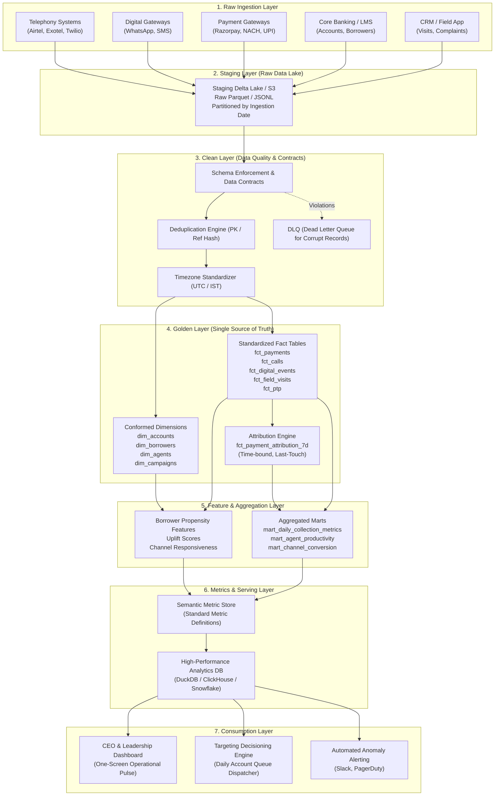

# CredResolve Production Analytics System Architecture

**Author:** Senior Data Analyst  
**Document Type:** Production Engineering Design & Architecture Specification (Part 5 Deliverable)  
**Status:** Approved for Implementation  

---

## 1. End-to-End System Architecture Diagram

---

## 2. Technical Specifications & Engineering Standards

### 2.1 Data Contracts & Schema Validation
All operational source systems must adhere to strict JSON Schema / Protocol Buffer data contracts at the ingestion gateway:
- **`payments` Contract:** Must contain non-null `payment_id`, valid `account_id`, positive numeric `amount`, recognized `payment_status` (`SUCCESS`, `FAILED`, `PENDING`, `REVERSED`), and UTC ISO-8601 timestamp. Uniqueness on `payment_id` is enforced via a deduplication bloom filter before writing to Staging.
- **`calls` Contract:** Must include `call_id`, `account_id`, `direction`, `duration_sec >= 0`, recognized `call_status`, and valid timezone identifier.
- **Contract Enforcement:** Schema drift or null values in primary keys trigger immediate rejection to the Dead Letter Queue (DLQ) with alert notification.

### 2.2 Primary Keys & Entity Resolution
- **Accounts:** Primary Key = `account_id`. Foreign key to `borrower_id`.
- **Borrowers:** Primary Key = `borrower_id`. Multiple contact entries resolved via SCD Type 2 or taking latest timestamp (`MAX(updated_at)`).
- **Agents:** Primary Key = `agent_id`. Historical assignment of multiple `employee_code` values is maintained in an agent audit bridge table, but all operational metrics aggregate strictly by `agent_id`.
- **Payments:** Primary Key = `payment_id`. Business Key = `(account_id, payment_reference)`.

### 2.3 Metric Definitions & Semantic Layer
All metrics are centralized in a declarative Semantic Layer (e.g., dbt Semantic Layer or Cube.js) to prevent divergent reporting:
- **Gross Recovery:** `SUM(amount) WHERE payment_status = 'SUCCESS'`.
- **Daily Normalized Recovery:** `Gross Recovery / COUNT(DISTINCT calendar_date)`.
- **Contact Rate:** `COUNT(call_id WHERE call_status = 'ANSWERED') / COUNT(call_id)`.
- **Right Party Contact (RPC) Rate:** `COUNT(call_id WHERE is_rpc = 1) / COUNT(call_id WHERE call_status = 'ANSWERED')`.
- **Promise-to-Pay (PTP) Kept Rate:** `COUNT(ptp_id WHERE status = 'KEPT') / COUNT(ptp_id WHERE status IN ('KEPT', 'BROKEN', 'CANCELLED'))`.
- **Cost per Rupee Recovered:** `Total Operating Expenses (Labor + Telecom + Digital + Field) / Total Clean Successful Recovery`.

### 2.4 Incremental Processing & Watermarking
- Ingestion pipelines run micro-batches every 15 minutes using Apache Spark / dbt incremental models.
- **Watermark Strategy:** Each fact table tracks `_ingested_at` and `event_at`. Queries look back with a dynamic 72-hour sliding watermark (`WHERE event_at >= CURRENT_DATE - INTERVAL 3 DAYS`) to capture updates and late reconciliations.

### 2.5 Late-Arriving Data & Backfills
- **Late-Arriving Payments:** Payments settling up to 14 days after a banking cycle are processed incrementally and dynamically re-evaluated against the 7-day attribution lookback window.
- **Partition Overwrites:** Analytical tables are partitioned by `event_month` and `event_date`. Historical corrections execute idempotent partition overwrites (`INSERT OVERWRITE ... PARTITION (event_date = 'YYYY-MM-DD')`), ensuring zero record duplication during backfills.

### 2.6 Data Quality Testing & Monitoring
Automated test suites (e.g., Great Expectations / dbt tests) run prior to promoting data from Clean to Golden:
1. **Uniqueness:** Zero duplicate primary keys on all dimensional and fact tables.
2. **Referential Integrity:** 100% of foreign keys in `fct_payments`, `fct_calls`, and `fct_daily_targeting` must resolve to existing records in `dim_accounts`.
3. **Value Assertions:** `amount > 0`, `duration_sec >= 0`, `payment_status IN ('SUCCESS','FAILED','PENDING','REVERSED')`.
4. **Volume Anomaly Checks:** Daily record count deviations $> 3\sigma$ from a 30-day rolling average trigger PagerDuty alerts.

### 2.7 Automated Anomaly Detection
- Real-time statistical monitoring on daily run-rate recovery.
- Automated day-count normalization to eliminate calendar false alarms (e.g., February vs March).
- Automatic detection of inactive account leakage into campaign dispatch queues (`account_master_status != 'ACTIVE'`).
